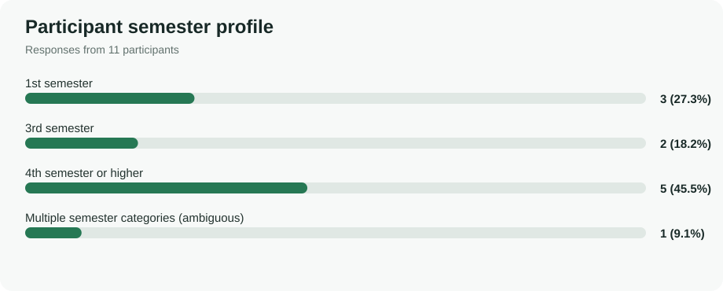
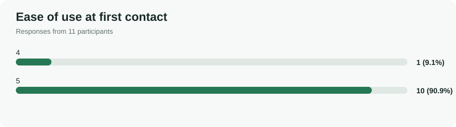
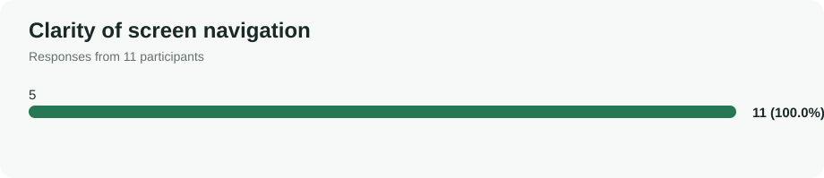
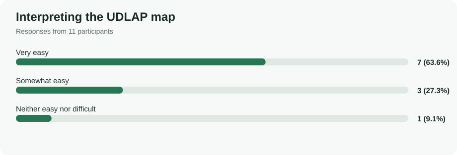
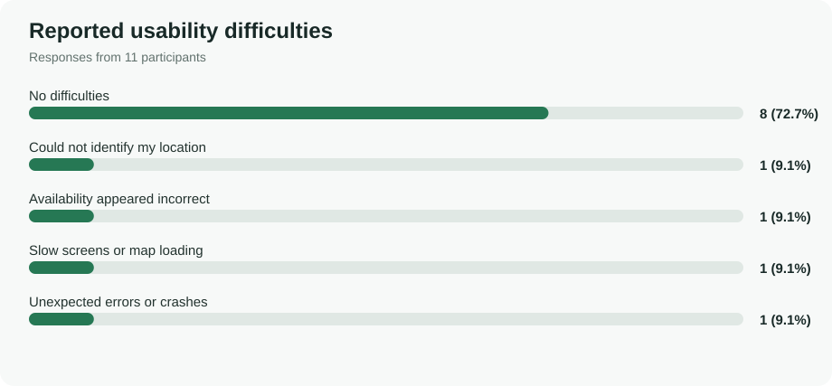
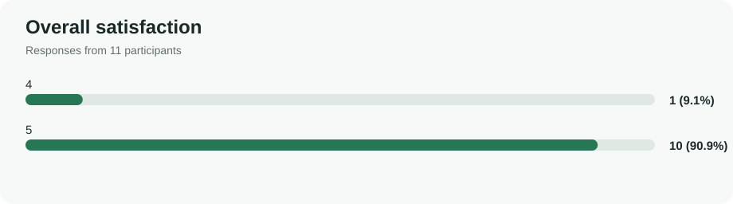
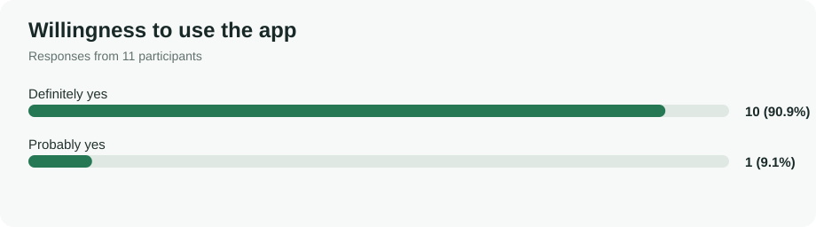

# UDLAP Smart Parking — Usability Testing Report

**Human–Computer Interaction | Universidad de las Américas Puebla (UDLAP)**

**Authors:** Sergio Emilio López Montalvo (186545) and Juan Diego Acosta Ojeda (185015)  
**Report language:** English · **Study:** 11 survey responses · **Project:** Mobile Smart Parking

> A usability evaluation of a mobile interface designed to help members of the UDLAP community identify parking availability, select an appropriate parking area and understand parking information more easily.

## Project overview

Finding parking close to a campus destination can be uncertain and time-consuming. UDLAP Smart Parking explores a mobile interface that presents parking areas and their availability in a clear, accessible format. The usability report documents participant feedback, analyzes potential friction points and proposes evidence-based improvements.

**[View the complete interactive HTML report](https://miliprogramador.github.io/Usability-Report/)**

## Study objectives and methodology

The questionnaire assessed first-use clarity, navigation, map interpretation, parking information, visual design, mobile comfort, difficulties, satisfaction and intention to use the app. **Eleven respondents** provided answers. Participants represented different academic semesters to gather perspectives from students who may have different levels of experience navigating the UDLAP campus.

Semester is an **approximate contextual indicator**, not a direct measure of campus familiarity. The survey does not establish that every first-semester student is unfamiliar with the university or that every advanced student knows the campus well.

The figures below show **descriptive survey results**, not directly observed task success, measured completion time or System Usability Scale (SUS) scores.

## Results at a glance

| Indicator | Survey finding |
|---|---|
| Participants | 11 |
| Initial ease of use | 10 of 11 rated it 5/5 |
| Navigation clarity | 11 of 11 rated it 5/5 |
| Map interpretation | 7 very easy, 3 somewhat easy, 1 neutral |
| Recognizing available parking areas | 11 of 11 reported no difficulty |
| Mobile comfort | 11 of 11 reported very comfortable |
| Overall satisfaction | 10 of 11 rated it 5/5 |
| Willingness to use | 10 definitely yes; 1 probably yes |

## 1. Participant profile



The sample includes **3 first-semester students, 2 third-semester students, 5 students in fourth semester or higher**, and one ambiguous response selecting multiple semester categories. This diversity is useful for collecting different viewpoints; it does not support causal claims about experience.

## 2. First-use experience



Ten participants rated initial ease **5/5**, and one rated it **4/5**. These responses suggest a positive first impression of the interface.

## 3. Navigation and orientation



All 11 respondents rated screen navigation **5/5**. This is a positive perception result, but should be followed by observed task-based testing.



Map interpretation was more varied: **7 very easy, 3 somewhat easy, and 1 neutral**. This suggests a useful opportunity to improve map labels, landmarks and the user's current-location indicator.

## 4. Usability difficulties



Eight participants reported no difficulties. Other responses included **difficulty identifying current location**, **apparently incorrect availability**, **slow screen/map loading**, and **unexpected errors or crashes** (one selection each). This question permitted multiple selections, so counts need not sum to 11.

## 5. Satisfaction and adoption potential



Ten respondents rated overall satisfaction **5/5**, and one rated it **4/5**.



Ten participants answered **Definitely yes** and one **Probably yes** when asked about willingness to use the app. These are stated intentions, not observed adoption.

## 6. Findings and recommendations

| Finding | Proposed improvement | Priority |
|---|---|---|
| Availability was reported as potentially inaccurate | Show last-updated timestamps and clearer data freshness information | High |
| Some uncertainty interpreting the map | Add recognizable campus landmarks, labels and an obvious current-location marker | High |
| One or more performance-related complaints | Test map loading, error handling and slower devices or connections | High |
| Some icons and buttons required explanation | Add clearer labels and improve icon consistency | Medium |
| Survey captures perceptions, not actual performance | Run moderated tasks with completion, time, errors and assistance metrics | High |

**Interpretation:** The survey indicates favorable perceived usability while also revealing concrete areas to validate and improve. The sample is small and non-random; percentages describe these respondents only.

## 7. Design iterations

The technical design described a simpler prototype centered on choosing a building, viewing nearby parking areas and registering a parking action. The current interface and survey provide a basis for evaluating the evolved mobile experience.

The next iteration should focus on **map orientation**, **availability reliability**, **clearer controls**, and **performance**. Proposed changes must be distinguished from changes already implemented; a second test is needed to measure improvement.

## 8. Repository structure

```text
UDLAP_Smart_Parking/
├── README.md
├── index.html
├── semester-profile.svg
├── ease-of-use.svg
├── navigation.svg
├── map-interpretation.svg
├── reported-difficulties.svg
├── satisfaction.svg
└── willingness.svg
```

## 9. View locally or publish on GitHub Pages

Open `index.html` in your browser to read the complete report. To publish it, upload this folder to a GitHub repository, then navigate to **Settings → Pages → Deploy from a branch**, selecting `main` and `/ (root)`. The charts in this README are local SVG files and will render automatically in GitHub.

## 10. References

- López Montalvo, S. E., & Acosta Ojeda, J. D. (2026, October 17). *Smart Parking App: Technical Design Report*. Universidad de las Américas Puebla. Unpublished course report.
- Smart Parking Project Team. (2026, November 11). *UDLAP Smart Parking — Encuesta de Usabilidad (respuestas)* [Unpublished survey dataset; 11 responses]. Universidad de las Américas Puebla.
- Nielsen, J. (1994). *Usability engineering*. Morgan Kaufmann.
- World Wide Web Consortium. (2023). *Web Content Accessibility Guidelines (WCAG) 2.2*. https://www.w3.org/TR/WCAG22/

---

*Academic project · Human–Computer Interaction · UDLAP*
